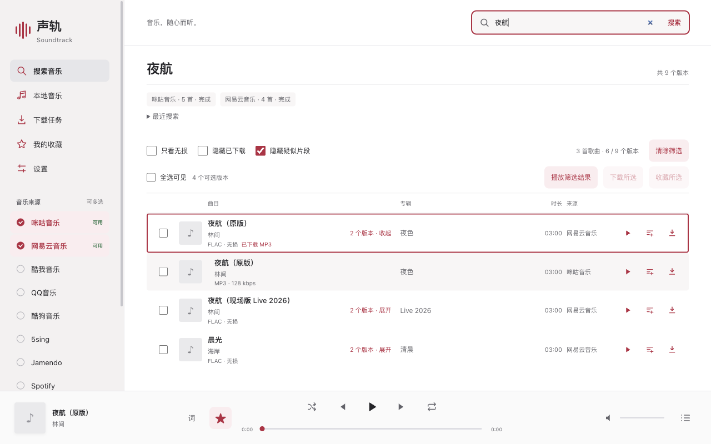

<div align="right">

[English](README.en.md) · **简体中文**

</div>

# 声轨 · Soundtrack

搜索喜欢的音乐，比较来源和音质，试听后下载到本地。

基于 [musicdl](https://github.com/CharlesPikachu/musicdl)，支持本机浏览器与 macOS / Windows 桌面应用。独立播放队列、同步歌词、收藏、本地音乐和批量 MP3 / 原始 FLAC 下载都在一个界面里。



截图展示当前源码，安装包功能以对应 Release 说明为准。

## 开始使用

在 [Releases](https://github.com/LiuKay/musicdl-soundtrack/releases) 下载适合系统的桌面包，完整解压后打开。macOS 首次打开若提示无法验证开发者，请按[首次打开说明](docs/first-launch.md)操作。

也可以运行源码：

```bash
python -m venv .venv
source .venv/bin/activate
python -m pip install -r requirements.txt
python app.py
# 打开 http://127.0.0.1:5000
```

Windows 使用 `.venv\Scripts\Activate.ps1` 激活环境。`PORT=8080 python app.py` 可更换端口。

## 五步上手

1. 输入歌名或歌手。默认搜索咪咕，可多选来源；更多来源可能需要更久。
2. 用无损、已下载和片段筛选缩小结果。展开「N 个版本」比较来源、格式和已知码率，现场版与伴奏保留各自名称。
3. 点击播放试听，或用「播放筛选结果」每首歌选一个默认版本。继续搜索不会打断当前队列。
4. 下载单首，或勾选后批量下载。默认 MP3，可在「设置」切换原始 FLAC 或每次选择；已有文件会先确认。
5. 到「本地音乐」找文件，在「我的收藏」保留曲目。缓存、播放位置、更新检查和快捷键都能从「设置」找到。

来源包括咪咕、网易云、酷我、QQ、酷狗、5sing、Jamendo、Spotify，可用性取决于网络与来源接口。短音频只提示可能为片段，也可能是完整作品；分组与音质默认选择不代表热度排行。

## 常见问题

- **文件在哪里？** 桌面版默认 `~/Downloads/Soundtrack/`，可在下载任务中选择目录；源码运行默认 `downloads/<源>/`。已完成任务和本地音乐都提供文件入口。
- **搜索失败怎么办？** 查看来源状态，单独重试失败来源，或切换来源。其他结果、已选歌曲和播放队列保留。
- **缓存能代替下载吗？** 缓存会自动清理，也不保证离线可用。长期保留请下载。
- **收藏和队列会保留吗？** 在当前浏览器或桌面应用中保存，重新打开后暂停。播放时重新获取同一版本，清除网站数据会移除这些记录。
- **如何更新？** 设置中查看当前版本和检查更新，点击发布页自行下载安装；可以关闭启动检查。

## 开发与验证

```bash
make test
make app  # macOS 构建，需要 Apple 命令行工具
```

Windows 构建、转换工具、任务恢复、存储规则和打包验收见[完整使用与开发说明](docs/usage.md)。

[手机搜索界面](docs/product-search-mobile.png) · [设置界面](docs/product-settings-desktop.png) · [发布指南](docs/releasing.md) · [产品计划](TODO.md) · [变更记录](CHANGELOG.md)

请尊重版权和平台条款。项目基于 [CharlesPikachu/musicdl](https://github.com/CharlesPikachu/musicdl) 构建，不提供账号或 Cookie 配置界面。
